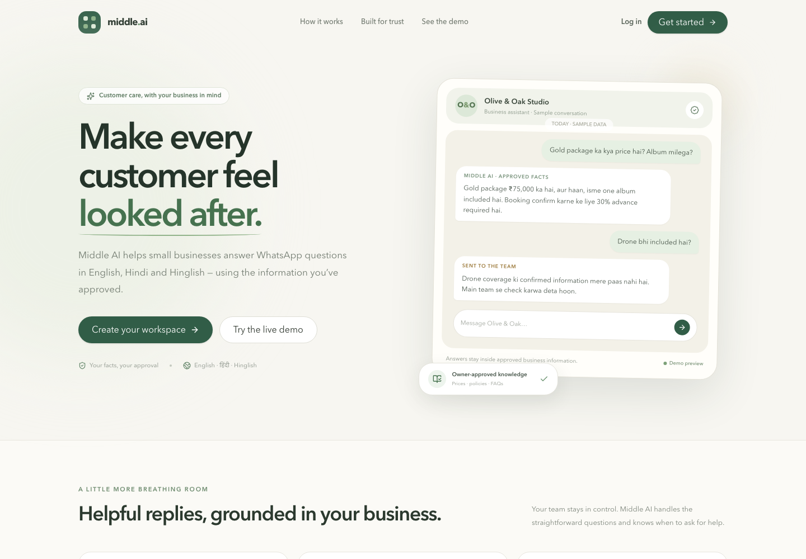
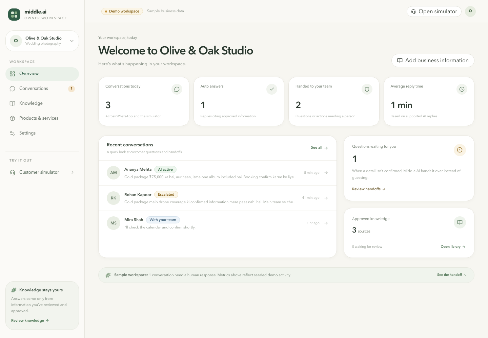
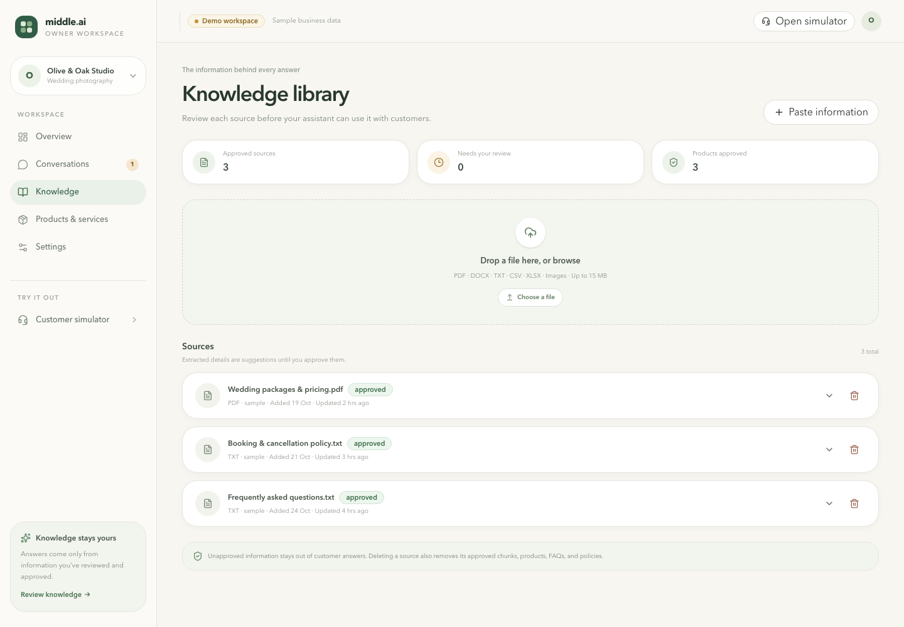
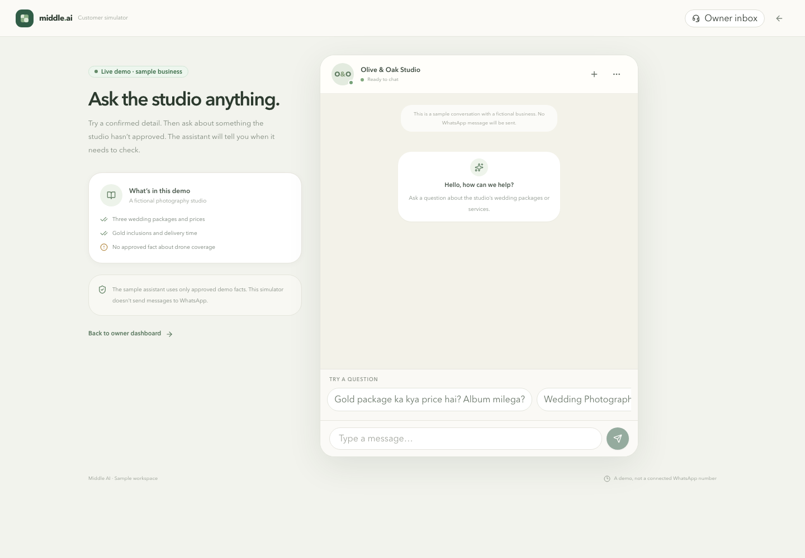

# Middle AI

Middle AI is a customer-support workspace for small businesses. It turns business documents and owner-approved information into grounded answers for WhatsApp, while keeping uncertain answers and sensitive requests with a human.

An owner can upload a price list, policy, FAQ, or other business document; review the extracted information; approve it; and try customer questions in a simulator. The app can also connect an official WhatsApp Business Cloud API number. A seeded photography studio makes the demo usable without external credentials.

## Screenshots

| Landing page | Owner dashboard |
| --- | --- |
|  |  |

| Knowledge library and document review | Customer chat simulator |
| --- | --- |
|  |  |

## Product flow

1. **Set up a workspace.** Create an owner account and describe the business, its services, hours, contact details, and supported languages. The sample workspace is available for a quick tour.
2. **Add business knowledge.** Upload a supported document or paste information. Middle AI extracts readable text and proposes facts, products, FAQs, and policies.
3. **Review and approve.** Suggestions stay out of customer answers until an owner checks and approves them. Owners can edit or reject suggestions.
4. **Try customer questions.** The simulator exercises the same answer flow and keeps the resulting conversation in the dashboard.
5. **Connect WhatsApp when ready.** Add an official WhatsApp Business Cloud API number and configure Meta to send webhook events to the deployed app. New workspaces begin in Draft only mode.

## Features

- Responsive owner dashboard with overview, conversations, knowledge, products and services, and WhatsApp settings.
- Document upload and pasted-text ingestion, with a review queue for extracted information.
- Structured product details including price, currency, price qualifier, availability, inclusions, and delivery time.
- Approved FAQs, policies, and source-backed document chunks for business questions.
- Customer simulator with prepared questions and saved conversations.
- English, Hindi, and Hinglish answer handling.
- Escalation for sensitive requests, unsupported details, and facts that cannot be verified.
- Conversation pause/resume, manual replies, draft editing and approval, and pending FAQ proposals.
- Official WhatsApp webhook verification, request-signature validation, duplicate-event protection, and Cloud API text replies.
- Supabase-backed accounts and workspace data with row-level security, private source-file storage, and workspace scoping.

## Document reading and OCR

The Knowledge library accepts files up to **15 MB** and checks the filename extension and MIME type before processing. Supported extensions are PDF, DOCX, TXT, Markdown, CSV, XLSX, PNG, JPG/JPEG, and WebP. Owners can also paste text directly.

| Input | How text is read |
| --- | --- |
| PDF | Reads the PDF's embedded text layer with `pdf-parse`. |
| DOCX | Extracts raw document text with Mammoth. |
| TXT, Markdown, CSV | Reads the file as UTF-8 text. |
| XLSX | Reads each workbook sheet and converts its cells to CSV-style text. |
| PNG, JPG/JPEG, WebP | Sends the image to the configured AI provider's vision input and asks it to transcribe legible business text. This needs a DeepSeek or OpenAI API key. |
| Pasted information | Processes the submitted text through the same suggestion and review workflow. |

Image text reading is vision-based OCR through the selected AI model; there is no separate local OCR engine. PDF handling reads embedded text only. A scanned or image-only PDF may produce no readable text and must be OCR'd before upload or supplied as an image. Images sent by customers to WhatsApp are recorded for human review; inbound WhatsApp media OCR is not implemented.

### Extraction and review stages

1. The upload endpoint checks the file type, MIME type, non-empty content, 15 MB limit, and rate limit.
2. The parser reads the source into text. Control characters are cleaned, line endings are normalized, and extracted content is capped at 120,000 characters. AI-based structured extraction receives at most 90,000 characters.
3. When a model is configured, it is asked to return explicit business facts, products, FAQ pairs, and policies as JSON. The response is validated with a Zod schema. The prompt instructs the model to omit uncertain details and not infer prices, policies, availability, inclusions, or promises.
4. If structured AI extraction is unavailable or fails, a conservative local fallback proposes selected fact-like lines, recognizable price rows, and clearly formatted FAQ/policy pairs. It does not replace a human review.
5. The source and its suggestions are saved with a **pending review** status. Only approved information can be used in customer answers. Editing or reprocessing a source disables its previous approved content until it is reviewed again.

This workflow is designed to reduce unsupported claims, but owners should still check the transcription and every extracted value against the original document. Small, blurry, handwritten, or poorly contrasted text can be misread by vision models.

## How customer answers are grounded

The agent first checks for sensitive requests such as refunds, cancellations, complaints, booking confirmations, payment disputes, negotiations, and regulated advice. Those requests are escalated to a person.

For other questions, Middle AI retrieves approved information from the active workspace only. It uses structured product fields for questions about price, inclusions, availability, and delivery; it searches approved FAQs, policies, and document chunks for other business questions. If a requested fact is missing or conflicting, it asks the team to confirm instead of guessing. Answer messages retain citations to their source records in the conversation data.

When an AI provider is configured, it may classify the message and rewrite a verified answer in a natural, concise style. Deterministic checks still provide the facts and guard the rewrite against added numbers, currency amounts, and unsupported terms. In Draft only mode, an answer is saved for owner approval rather than sent automatically.

## Architecture

- **Web app:** Next.js App Router, React, TypeScript, and Tailwind CSS.
- **Authentication and persistence:** Supabase Auth and Postgres. Workspace membership scopes owner access; row-level security protects business records.
- **Knowledge storage:** Approved facts, products, FAQs, policies, and chunks are stored per workspace. Uploaded originals use the private `knowledge-source-files` Supabase Storage bucket.
- **AI provider:** `src/lib/ai-provider.ts` selects DeepSeek when `DEEPSEEK_API_KEY` is set; otherwise it selects OpenAI when `OPENAI_API_KEY` is set. DeepSeek uses the OpenAI-compatible Responses API. OpenAI embeddings are an optional separate capability.
- **Search:** OpenAI `text-embedding-3-small` embeddings and pgvector search are used when `OPENAI_API_KEY` is configured. Without that key, approved chunks use local lexical matching.
- **WhatsApp:** Meta WhatsApp Business Cloud API webhooks and send-message API. Per-workspace access tokens are encrypted with AES-256-GCM before database storage.
- **Local demo:** A seeded sample workspace runs without Supabase, AI, or Meta credentials. Its in-memory changes reset when the server restarts and are not shared across app instances.

### Main routes

| Route | Purpose |
| --- | --- |
| `/` | Product landing page |
| `/dashboard` | Workspace overview |
| `/dashboard/conversations` | Customer conversations, replies, and review queue |
| `/dashboard/knowledge` | Upload sources and review extracted knowledge |
| `/dashboard/products` | Review and manage products and services |
| `/dashboard/settings` | Workspace and WhatsApp settings |
| `/demo/chat` | Customer-facing simulator |
| `/login` | Owner sign-in and account creation |
| `/onboarding` | Create the first workspace |
| `/api/ingest` | Document ingestion endpoint |
| `/api/whatsapp/webhook` | Meta webhook verification and event receiver |

Useful source files:

- `src/lib/documents.ts` — file validation, parsing, image transcription, and structured suggestions.
- `src/lib/safe-agent.ts` — intent handling, approved-context retrieval, escalation, and answer safety checks.
- `src/lib/ai-provider.ts` — DeepSeek/OpenAI provider selection and Responses API calls.
- `src/lib/semantic-search.ts` — optional embeddings and vector retrieval.
- `src/lib/whatsapp.ts` and `src/app/api/whatsapp/webhook/route.ts` — WhatsApp token encryption and webhook processing.
- `supabase/migrations/202610310001_middle_ai.sql` — tables, policies, indexes, private file bucket, and sample data.
- `IMPLEMENTATION_PLAN.md` — implementation scope and product plan.

## Requirements

- Node.js 22 or newer and npm.
- Supabase project for persistent accounts, workspace data, uploads, and real WhatsApp connections.
- DeepSeek or OpenAI API key for AI-based intent classification, answer wording, structured extraction, and image text transcription.
- OpenAI API key for semantic embeddings, including when DeepSeek is used for chat and extraction.
- Meta developer app and WhatsApp Business Cloud API number for real WhatsApp delivery.

The seeded simulator can be used without these services. Without Supabase credentials, the app intentionally uses the local sample workspace rather than creating a persistent account.

## Run locally

```bash
npm install
cp .env.example .env.local
npm run dev
```

Open [http://localhost:3000](http://localhost:3000), choose **Try the live demo**, or go to `/demo/chat`. The owner dashboard is at `/dashboard`.

## Environment variables

Copy `.env.example` to `.env.local` and add only credentials for integrations you use.

| Variable | Purpose |
| --- | --- |
| `NEXT_PUBLIC_APP_URL` | Public app origin used for webhook configuration and links. |
| `NEXT_PUBLIC_SUPABASE_URL` | Supabase project URL. |
| `NEXT_PUBLIC_SUPABASE_ANON_KEY` | Supabase public/anon key for auth. |
| `SUPABASE_SERVICE_ROLE_KEY` | Server-only key for webhook processing and encrypted WhatsApp credential storage. Never expose it to a browser. |
| `DEEPSEEK_API_KEY` | Server-only DeepSeek API key. When present, DeepSeek takes precedence for AI text and vision requests. |
| `DEEPSEEK_MODEL` | Optional DeepSeek model override; default is `deepseek-flash`. |
| `OPENAI_API_KEY` | Server-only OpenAI key. Used for AI if no DeepSeek key is set, and for embeddings even when DeepSeek handles AI text. |
| `OPENAI_MODEL` | Optional OpenAI model override; default is `gpt-4.1-mini`. |
| `WHATSAPP_VERIFY_TOKEN` | Shared secret used during Meta webhook verification. |
| `WHATSAPP_APP_SECRET` | Meta app secret used to validate `X-Hub-Signature-256`. |
| `WHATSAPP_ACCESS_TOKEN` | Optional platform-controlled demo number token. Business-specific tokens are entered in Settings and encrypted before storage. |
| `WHATSAPP_PHONE_NUMBER_ID` | Phone number ID for an optional platform-controlled demo number. |
| `WHATSAPP_BUSINESS_ACCOUNT_ID` | WABA ID for an optional platform-controlled demo number. |
| `WHATSAPP_API_VERSION` | Optional Graph API version; default is `v26.0`. |
| `TOKEN_ENCRYPTION_KEY` | 32-byte encryption key as 64 hexadecimal characters or Base64, used for stored WhatsApp tokens. |

Generate a token-encryption key with:

```bash
openssl rand -hex 32
```

Do not commit `.env.local`. Only variables prefixed with `NEXT_PUBLIC_` are intended for browser use.

## Supabase setup

1. Create a Supabase project and add the URL, anon key, and service-role key to `.env.local`.
2. Apply [`supabase/migrations/202610310001_middle_ai.sql`](supabase/migrations/202610310001_middle_ai.sql) with the Supabase SQL editor or CLI.
3. Confirm that the migration created the private `knowledge-source-files` bucket and seeded the Olive & Oak sample workspace.
4. Start the app and create an owner account at `/login`, then complete `/onboarding`.

The migration creates workspace-scoped records and row-level security policies. Keep the service-role key on the server because it bypasses row-level security. Auth uses Supabase Auth rate limits; application actions, uploads, and webhooks also use the migration-backed rate-limit RPC when Supabase is configured.

## Configure AI

Set `DEEPSEEK_API_KEY` in `.env.local` to select DeepSeek. The app calls the OpenAI-compatible Responses API at `https://api.deepseek.com`; `DEEPSEEK_MODEL` can override the default model. DeepSeek takes priority if both DeepSeek and OpenAI keys are present.

For semantic search, also set `OPENAI_API_KEY`. The app uses OpenAI `text-embedding-3-small` for embeddings while DeepSeek can continue handling chat, extraction, and image transcription. Without an AI key, text files can still be parsed and the local fallback can propose limited suggestions; image uploads require a configured vision-capable model.

## Connect WhatsApp

Middle AI connects to an **official WhatsApp Business Cloud API number**. A personal WhatsApp account cannot connect through the current settings flow. Meta also needs to reach the app over HTTPS; a local `localhost` URL is not a live webhook endpoint. See Meta's [WhatsApp Business Platform documentation](https://www.postman.com/meta/whatsapp-business-platform/documentation/wlk6lh4/whatsapp-cloud-api) for Cloud API onboarding.

1. Configure Supabase and `TOKEN_ENCRYPTION_KEY`.
2. In **Settings → WhatsApp connection**, enter the phone number ID, WhatsApp Business Account ID, display number, and a long-lived access token.
3. Set the webhook callback URL in Meta to `https://<your-domain>/api/whatsapp/webhook`, subscribe with the same `WHATSAPP_VERIFY_TOKEN`, and enable WhatsApp message events.
4. Set `WHATSAPP_APP_SECRET` so incoming POST signatures are checked.
5. Start in Draft only mode and verify the flow with Meta's test recipient before handling customer messages.

The app encrypts each workspace token with AES-256-GCM before storage and does not return it to dashboard state. A platform demo number can instead use `WHATSAPP_ACCESS_TOKEN`, `WHATSAPP_PHONE_NUMBER_ID`, and `WHATSAPP_BUSINESS_ACCOUNT_ID`; only messages for that number route to the seeded demo workspace.

### Webhook behavior and limits

- `GET /api/whatsapp/webhook` checks Meta's mode and verify token, then returns the challenge.
- `POST /api/whatsapp/webhook` validates the raw request body using the HMAC SHA-256 signature, resolves the workspace by phone number ID, deduplicates WhatsApp message IDs, and queues supported message processing.
- Incoming text is stored and answered from approved workspace information. In Draft only mode, the response is saved as a draft. Sending requires a connected Cloud API number and an automation mode that permits it.
- Images and voice notes are added to the inbox for human review. They are not automatically downloaded, OCR'd, or transcribed.
- Meta Embedded Signup is not implemented. The current connection is a manual credential form.

## Seeded demo

The sample workspace is Olive & Oak Studio, a wedding photography business. It includes Silver at ₹45,000, Gold at ₹75,000, and Premium at ₹1,20,000. The Gold package explicitly includes two photographers, one videographer, edited photographs, and one album, with a 6–8 week delivery estimate and 30% booking advance. Drone coverage is intentionally unconfirmed; asking about it should be escalated.

## Verification

```bash
npm run lint
npm run typecheck
npm test
npm run build
```

## Deploy to Vercel

1. Import the GitHub repository into Vercel and use the Next.js build defaults.
2. Add the required environment variables to the Production environment; add Preview values if needed. Keep service-role, AI, Meta, and encryption secrets server-only.
3. Apply the Supabase migration before enabling account or webhook traffic.
4. Set `NEXT_PUBLIC_APP_URL` to the deployed HTTPS origin and configure Meta's webhook URL and verify token.
5. Deploy and verify the simulator and dashboard. Then test with a Meta test recipient before routing real customer conversations.

## Known limitations

- The credential-free demo uses process memory and resets on server restart; it is not persistent or suitable for multi-instance production use.
- Account persistence, private uploads, and workspace WhatsApp connections need Supabase and the included SQL migration.
- PDF parsing reads text layers only; scanned PDFs need an OCR step before upload or can be supplied as images.
- Image transcription depends on the configured AI provider and image quality. Always compare extracted details with the source document.
- Inbound WhatsApp images and voice notes require human review; automatic media OCR and transcription are not implemented.
- The local extractor is intentionally conservative and may miss complex product formats. Review all suggestions before approval.
- Without OpenAI embeddings, search over approved chunks uses lexical matching. The credential-free rate-limit fallback is also in-memory and per process.
- This is an MVP demo. Billing, analytics, Meta Embedded Signup, and a production compliance program are outside its current scope.
